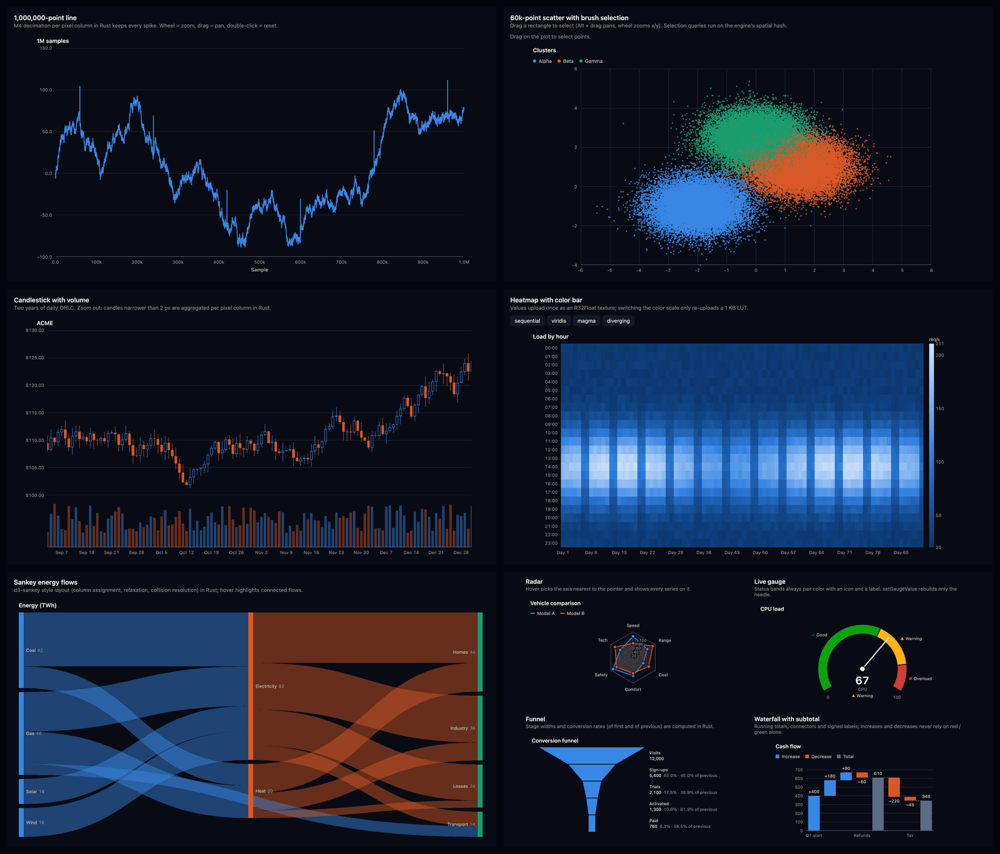
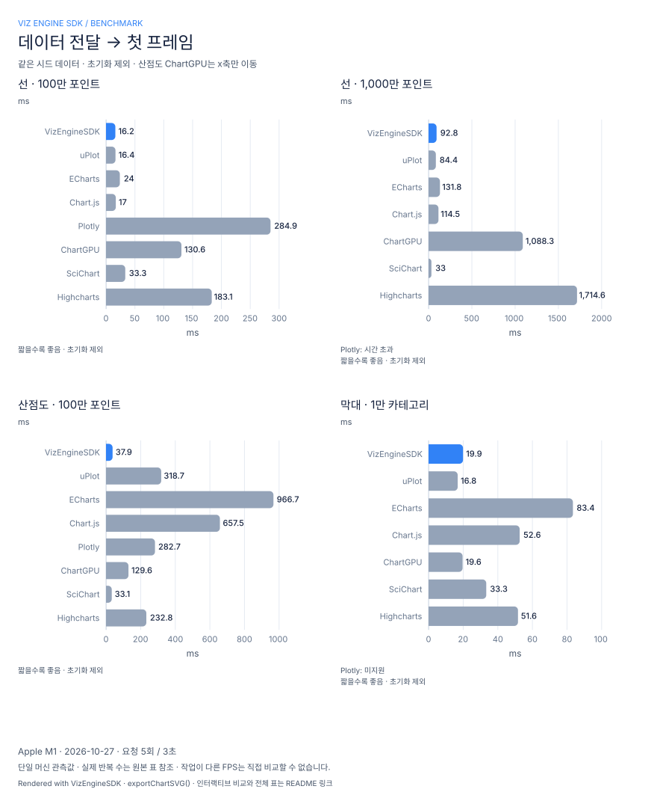
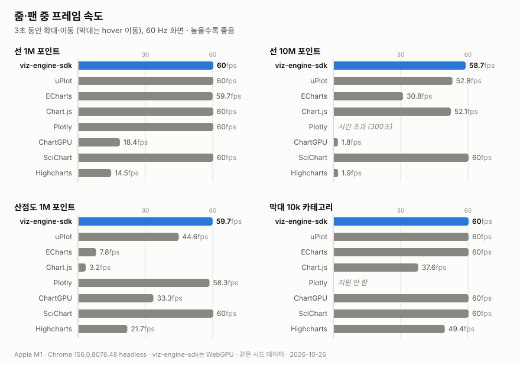
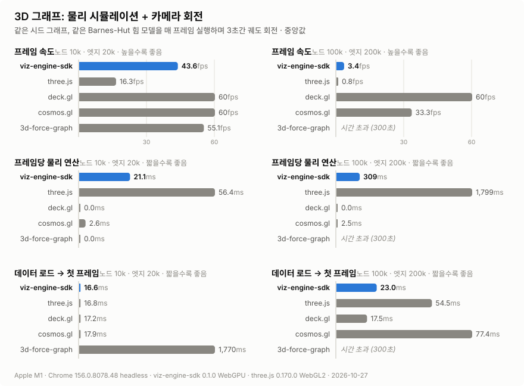

# VizEngineSDK

**Rust + WebGPU로 만든 대용량 웹 차트 라이브러리.** 100만~1000만 포인트를 60 FPS로 줌·팬합니다.
WebGPU가 없는 브라우저에서는 WebGL2로 자동 전환됩니다.

[](https://github.com/jparkk0517/VizEngineSDK/actions/workflows/ci.yml)
[](LICENSE)

**[▶ 라이브 데모](https://jparkk0517.github.io/VizEngineSDK/)** · [사용 가이드](docs/GUIDE.md) · [벤치마크](docs/BENCHMARKS.md) · [변경 기록](web/CHANGELOG.md)

<p align="center">
  <a href="https://jparkk0517.github.io/VizEngineSDK/"></a>
</p>

## 왜 VizEngineSDK인가

- **큰 데이터에서 빠름**: 데이터 축약(M4), 마우스 위치 판정, 누적 계산, 눈금 배치를 전부 Rust(WebAssembly)에서 하고 GPU로 그립니다. DOM은 라벨·범례·툴팁만 담당합니다.
- **차트 18종**: 선, 영역, 막대, 산점도, 캔들스틱, 히스토그램, 히트맵, 박스·바이올린, 파이, 콤보, 레이더, 게이지, 퍼널, 워터폴, 트리맵, 선버스트, 생키, 스파크라인
- **실사용 기능**: 실시간 스트리밍, 시간 축, 로그 축, 휠·드래그·핀치 줌, 범위 내비게이터, 브러시 선택, 대시보드 동기화, PNG·SVG·PDF 내보내기
- **접근성**: 모든 차트에 자동 요약, 데이터 표, 키보드 탐색
- **React · Vue 컴포넌트** 제공, TypeScript 타입 포함
- **디자인 설정**: 라이트/다크·커스텀 테마, 시리즈 색상·팔레트, 글꼴, 격자·툴팁, 막대 모서리·데이터 라벨 ([직접 바꿔 보기](https://jparkk0517.github.io/VizEngineSDK/benchmarks.html))
- **3D**: 대규모 네트워크 그래프(Barnes-Hut 물리 배치, 최단 경로, 검색), 고차원 임베딩 3D 투영과 유사도 검색, 강체 물리가 있는 3D 장면 ([예제](https://jparkk0517.github.io/VizEngineSDK/graph.html))

## 성능

**[▶ 인터랙티브 성능 비교 · 테마/색상 바꾸기](https://jparkk0517.github.io/VizEngineSDK/benchmarks.html)**

아래 그래프는 **VizEngineSDK로 렌더링하고 `exportChartSVG()`로 내보낸 이미지**입니다. 비교 페이지에서는 시나리오 선택, 툴팁, 4개 테마, 강조 색상·팔레트·글꼴·모서리·수치 표시 변경과 SVG 다운로드를 지원합니다.

같은 시드 데이터로 uPlot, ECharts, Chart.js, Plotly, ChartGPU, SciChart, Highcharts와 비교합니다. Apple M1의 단일 환경 측정이며, 초기화 비용은 TTFF에서 제외합니다. ChartGPU 산점도는 x축만 이동하므로 다른 라이브러리와 작업량이 다릅니다.

<picture>
  <source media="(prefers-color-scheme: dark)" srcset="docs/assets/bench-ttff-dark.svg">
  
</picture>

<picture>
  <source media="(prefers-color-scheme: dark)" srcset="docs/assets/bench-fps-dark.svg">
  
</picture>

그래프는 **작업 조건별로** 읽어야 합니다. viz·three.js는 같은 3D Barnes-Hut 힘 모델, deck.gl은 물리 없는 렌더, cosmos.gl은 2D GPU 레이아웃, 3d-force-graph는 다른 d3-force-3d 힘 모델입니다. 이들의 FPS를 동일 작업의 종합 순위로 해석하지 않습니다. 시간 초과는 해당 어댑터·설정에서의 결과입니다.

<picture>
  <source media="(prefers-color-scheme: dark)" srcset="docs/assets/bench-graph-dark.svg">
  
</picture>

측정 방법, 각 라이브러리 설정, 전체 표와 한계는 [docs/BENCHMARKS.md](docs/BENCHMARKS.md)에 있습니다. 직접 돌려 보려면 `cd web && npm run bench`.

README 이미지 재생성: `cd web && npm run bench:charts` (Chrome 필요). 비교 페이지는 `npm run examples:dev` 후 `/benchmarks.html`에서 실행할 수 있습니다.

## 설치

> npm 배포 전입니다. 지금은 [소스에서 빌드](docs/DEVELOPMENT.md)해서 쓰세요.

```bash
npm install viz-engine-sdk
```

Vite, webpack 5 등 번들러는 wasm 파일을 자동으로 처리합니다. 번들러 없이 `<script>`로 쓰거나 esbuild를 쓰는 경우는 [패키지 README](web/README.md#installation)를 보세요.

## 빠른 시작

```ts
import { VizEngineSDK } from 'viz-engine-sdk';

const canvas = document.querySelector('canvas')!;
const sdk = await VizEngineSDK.create(canvas);

// 100만 포인트 선 그래프
const values = Float32Array.from({ length: 1_000_000 }, (_, i) => Math.sin(i / 5000) * 40 + Math.random() * 4);
sdk.renderLineChart([{ name: '센서 A', values }], { title: '실시간 텔레메트리' });

// 툴팁, 휠 줌, 드래그 이동
sdk.enableNodeInteractions(canvas, { autoRender: true });
sdk.render();
```

React:

```tsx
import { VizChart } from 'viz-engine-sdk/react';

<VizChart type="line" data={series} options={{ title: '사용률' }} style={{ height: 300 }} />;
```

차트 종류별 예제와 소스는 [라이브 데모](https://jparkk0517.github.io/VizEngineSDK/)에서 볼 수 있습니다.

## 브라우저 지원

| 렌더러 | 브라우저 |
|---|---|
| WebGPU | Chrome · Edge 113+, Safari 26+ |
| WebGL2 (자동 전환) | 그 외 최신 브라우저 |

## 문서

- [사용 가이드](docs/GUIDE.md): 차트별 옵션, 상호작용, 내보내기, 3D 그래프
- [npm 패키지 README (영문)](web/README.md): 엔트리별 설치 방법, 영문 사용 예제
- API 레퍼런스: `cd web && npm run docs` (TypeDoc → `docs/api/`)
- [벤치마크](docs/BENCHMARKS.md): 측정 방법과 전체 결과
- [개발 · 빌드 · 테스트](docs/DEVELOPMENT.md): wasm 빌드, 라이브러리 빌드, GPU 화면 회귀 테스트
- [배포 절차](docs/RELEASING.md)

## 라이선스

[MIT](LICENSE)
